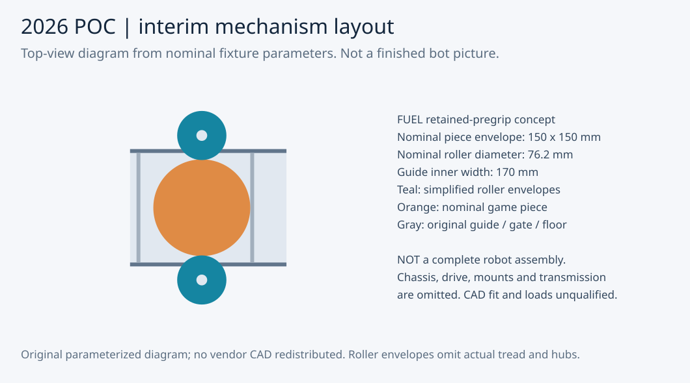

# 2026 REBUILT proof of concept



**Interim subsystem concept, not a complete assembled robot.** The top image shows a nominal mechanism fixture. It is not a picture of a complete robot. Chassis, motors, rails, supports and transmission are not assembled.

## Design highlights

- **Fixed-angle HUB approach and launch** with one preloaded FUEL.
- 60 degree guide, 0.3 m powered travel, 0.0005 kg m2 inertia per roller, refined duty 0.6.
- Ideal differential-drive approach, 200 ms stopped handoff, virtual pregrip/gate interlocks and powered roller model using WPILib DCMotor/shared supply.
- 12 V gives about 252 mm whole-sphere thin-plane margin; 9 V fails.
- **No official scoring or hardware safety acceptance is claimed.**

## Run on Windows

Requires existing Python 3, PowerShell, Git, JDK 17 and populated Gradle/WPILib cache. No installation or robot deployment is performed.

```powershell
./run.ps1 -JavaHome '<existing JDK17 directory>' -GradleHome '<existing populated Gradle cache>'
```

Open the printed results directory: `SUMMARY.md`, `season-results.json` and `robot-run/receipt.json`. Each invocation executes the unchanged shared three-season regression, then selects this season's results. The extra regressions are deliberate shared-model checks, not other season projects owned by this repository. Fresh output directories and run IDs prevent reusing old passing XML.

## What lives here

- `cad/`: original fixture STEP, editable OCP generator and dimensions, overview SVG, and earlier sideplate SVG/DXF. No vendor CAD or fabrication-ready assembly.
- `shared/examples/java-2026-sim/src/`: actual Java controller/plant and integration tests, not a link to unavailable code.
- `shared/scripts/`: actual execution, finite-body target and evidence checks.
- `config.json`: season design description checked against pinned runtime duty/inertia. It is not yet a general tuning interface.
- `DESIGN.md`: design scope, assumptions and remaining work.
- `PROVENANCE.json`: exact source commit and file hashes; no Git history or private vault included.

The shared source snapshot is derived from agent-frc commit `21d785397cd08ca9dc5bf5f9849996ab508c9a49`. That development commit need not be accessible remotely to run this checkout. Gradle 8.11, GradleRIO/WPILib 2026.2.1 and JUnit 5.10.1 are pinned; 2024/2025 are game models using the 2026 desktop toolchain, not historical toolchain builds. See [dependency notices](shared/examples/java-2026-sim/THIRD_PARTY.md).

## Open and edit CAD

Open `cad/2026-original-fixture.step` in a STEP-capable CAD tool. Eight exported shapes describe the original floor/gate/guides, simplified rollers and nominal piece. The companion JSON records parameters and limitations. Export and STEP reopen were checked, not fit, loads or fabrication readiness. With an existing OCP 8.0.1 Python environment, regenerate using:

```powershell
python cad/build_original_fixture.py --season 2026 --output artifacts/cad
```

The top view is illustrative and omits guide-slot detail; STEP is the geometric artifact. CAD is not yet coupled automatically to the plant.

Only the documented run entry is supported by this minimal snapshot. Legacy tasks named in the retained upstream build file may have intentionally omitted sources. The configuration is a pinned description: edits are rejected, not silently treated as plant tuning. Shared source and CAD bytes are preserved by .gitattributes; other text uses LF.

## Public contribution checks

Run `python -m unittest discover -s tests` and `python scripts/check_public_content.py` after committing changes. The guard checks committed bytes, private paths/network addresses, unexplained machine aliases and binary additions. Reports identify file/category only. Manually review images/CAD metadata and novel formats before publishing; pattern checks are not a complete privacy guarantee.
