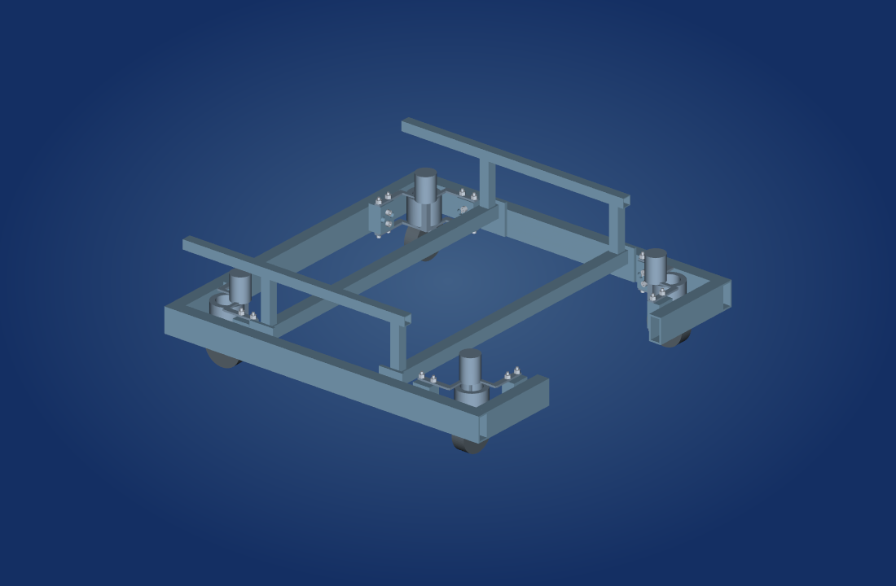

# Assembly engineering record

The student archive for R2C-T1 contains 159 editably extruded bodies and two tower sliders. Exact file and contact reviews exposed defects in the complete robot. All 159 bodies reopened with the native physical material “Steel.” Their raw CAD mass was 350.493 kg. The selected battery, drivetrain units, clear guards and bumper covers all require different treatment. The engineering review also found 116 original parts outside the existing tower rigid groups, seven isolated physical parts in the parked STEP, and interference between the intake roller and elevator structure. These observations invalidate any claim of a finished whole-robot mass or build release from the earlier screenshot.

## Issued student chassis

[Open the foundation orbit](https://ehartye.github.io/frc-2026-poc/detailed-design/archive/draft-001/foundation/) · [Download the editable Fusion robot](foundation-student.f3d) · [Inspect the complete first-party STEP](foundation-student.step)

The orbit isolates the 109 revised articles. The F3D contains all 235 current occurrences. The 126 inherited articles retain their earlier game-study scope. The [all-product comparison](reopened-products.json) checks each revised article against its planned machining and each inherited article against its original STEP product. The issue passes counts, volumes, centroids and bounding boxes on all 235. All 16 long screws are continuous through both tab planes, with a measured shank cross-section of 18.292 mm². At an offset of 0.04 mm all 32 sections clear; 0.15 mm registers contact at both finite plates on every screw.

A withdrawn development archive failed this comparison on 30 products. Default Fusion cut participants allowed machining to spill into adjacent occurrences, and replacing those later occurrences removed intended cuts from earlier parts. Limiting each machining operation to its own body and restoring the missing 23 operations fixed all 30 differences. The independent [native readback](reopened-native.json) found one anchored rear rail, 97 fixed installed articles, eight chassis-relative swerve joint motions, and the two historical tower sliders. In the [combined wheel-motion check](coupled-wheel-check.json), steering measured 0.630064 rad and wheel rotation 0.799361 rad at each of four modules. The spin axis followed the steered fork. The signed direction follows the assembly datum at each corner.

The [mass reconciliation](foundation-mass.json) gives **12.541 kg** for the represented drivetrain foundation. This includes 5.233 kg of fabricated stock, 0.428 kg of modeled fasteners and four 1.720 kg purchased module assemblies. All 109 native body volumes agree with the reopened STEP and the shop recipe within 0.1%. The full native CAD still totals 325.025 kg because of unresolved materials on inherited articles; competition mass remains open. The [supplier fit](reopened-module-fit.json) checks 213 exact first-party articles against the purchased placements, with zero conflicts on all four corners across 64 tool operations. The [private master receipt](private-relink-receipt.json) documents the four installed supplier modules and two historically selected scoring motors. Authorized supplier geometry remains project-local.

## Drivetrain foundation

The new [shop traveler](foundation-shop.md) and [saddle drawing](foundation-saddle.svg) revise the chassis mounts. The collision check uses the original supplier STEP SHA-256 from the [selected part record](../own-zone/layout.json) at the four revised placements. Public student files contain independently drawn package geometry.

| Check | Original R2C-T1 or initial candidate | Revised foundation |
| --- | --- | --- |
| Saddle height | Original 33.18 mm span in a 50.80 mm gap | 50.80 mm nominal. Machine for the matched pair of real plate faces. |
| Module position from center | ±268 mm. The original upper tab intersects a frame crossmember and hopper post, and the conservative continuous-turn envelope enters the inner rail faces. | ±265 mm. All 72 purchased supplier leaves per module checked against the full parked robot. The analytic full-azimuth envelope clears. |
| Rail fastening and access | Pending mount. In the prototype saddle study the two rear inboard screw paths strike the original crossmember. | Sixteen M6 screws plus sixteen matched long screw/locknut pairs. The four completed-backplate frame corners pass 64 separate key, screw-withdrawal and vertical socket tests. |
| Bearing on module plates | No matched full-height support | Minimum 327.0 mm² per half-saddle on each supplier plate. With the actual cap screw, minimum 21.2394 mm² conservative under-head seat and 46.8411 mm² nut seat. |
| Crossmember support | On the intermediate flat-sided rail the top 7.20 mm of each crossmember extended above its rail. | Four backing plates support the complete 282.2575 mm² crossmember end section. The crossmember-to-plate and plate-to-rail contacts have zero nominal gap and zero common volume. |
| Reproduction | [Original tower archive and assumptions](../tower-lift) | [Supplier geometry checks](drivetrain_fit.py), [seat area measurement](tab_seats.py), [section checks](frame_bearing.py), [editable Fusion construction](fusion_foundation.py), [private purchased-parts relink](private_relink.py) |

The complete robot is still in engineering review. The earlier single-piece scoring replay and tower assessment preserve their original model revision. The source schema and cuts for the revised drivetrain use actual stock and hardware identifiers. Completed fit at this interface is separate from an as-built clamp load, measured mass, wiring test or full-robot acceptance.
