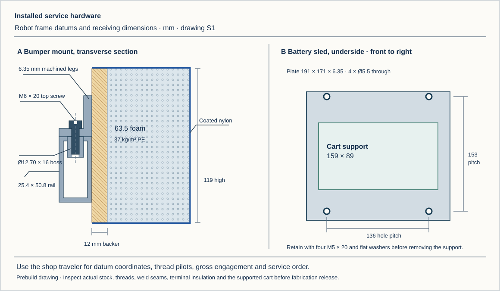

# Removable bumpers, battery well and electronics deck

This drawing package covers the installed chassis service hardware in robot coordinates. X is forward, Y is left and Z is height above the carpet datum. Dimensions are millimetres. All five bumper sections, the cart-supported MK ES17-12 battery sled and four electronics deck sections use the issued foundation rails. The existing scoring and climbing recordings remain tied to the robot identified in each experiment.

[Parked seat and thread measurements](service-seats.json) · [Five-panel withdrawal and module access](bumper-service-fit.json) · [Earlier failed mounts](bumper-alternatives.json) · [Rear ratchet envelopes](bumper-ratchet-fit.json) · [Battery and service-cart clearance](battery-service-fit.json)

## Five individually removable bumpers

| Segment | Backer length | Tangential stations | Frame datum |
|---|---:|---|---|
| Left and right sides | 680 | X −231.5, −95, 90, 265 | Y +327.3 and −327.3 |
| Rear | 680 | Y −150, 0, 150 | X −327.3 |
| Left front | 190 | Y 178, 274 | X +327.3 |
| Right front | 190 | Y −274, −178 | X +327.3 |

Cut the 12 mm nine-ply birch to 119 mm high. At each station the backing begins at the perimeter plane, 340 mm from the center. Install a 36 mm long 6061 mounting angle cut from 31.75 mm square bar. Mill a 25.40 mm foot, 31.75 mm overall height and two 6.35 mm legs. Face square and locate the top hole at the tangential center, 12.70 mm inboard of the rail's outer face. Drill the foot Ø6.60. Locate both M5 flanges at Z135 and station ±10. Drill Ø4.20 and tap M5×0.8 through. The matching wood has two Ø5.50 through holes and Ø16.50 by 4.50 deep outer recesses. Seat one 15 mm outside-diameter steel washer, 1 mm thick, and one M5×16 button screw in each recess. The modeled head finishes 0.75 mm below the outside wood face. Keep head and washer entirely below the face after compression.

Bore the rail crown Ø12.80 for a 12.70 mm diameter by 16 mm long 6061 boss. Face its top flush with Z114.80. Pilot Ø5.00 and tap M6×1 after welding. Assemble one ISO 4762 M6×20 socket screw per station. Its head sits on Z121.15 and nominal gross thread overlap is 13.65 mm. Gauge real thread start, tap runout and bolt length before use. Fifteen bosses, fifteen angles and fifteen top screws serve the five segments; the wood interfaces use thirty button screws and thirty large-face washers.

For the drilled plate and machined angle, hold hole centers within ±0.10 of the registered station and stock face. Use the actual foot as a jig for the rail boss with the backer flat against the perimeter face. Verify assembly without forcing the screw or bending the wood. Check after welding. The weld boss fits through the rail top wall with a nominal 0.05 radial gap. A continuous accessible fusion weld and subsequent flush finishing are required for the load path. Qualify weld preparation, finished throat and actual clamp/impact performance on a representative coupon before releasing fabrication.

Place 63.5 mm of Sealed Air Ethafoam 220 PE on the continuous backer. Machine or cut the two long side end returns as shown in the editable padding bodies, preserving the corner volume. The 37 kg/m³ catalog foam falls within the R402 PE range at the kickoff cutoff. The finished modeled face projects 76 mm, including 0.5 mm coated 1000D Cordura cloth. The long front gap is 300 mm and each protected front corner has 190 mm of backing. Model padding and backer height is 119 mm and padding depth is 63.5 mm. Check the full R401–R412 inspection against the covered, uncompressed assembly and its installed height.

Sew red and blue sets to the same profile. Keep seam allowance and recessed inward fastening off the contact faces. Weigh seams, closures, staples and any bonding material separately. Verify the upholstery attachment on scrap and prevent foam movement under the cover. A team number has not been supplied. Before event use the actual project number must appear in white at three approximately orthogonal views, with at least 95.25 mm character height and generally 12.7 mm stroke. Preserve clear digits at the seams. Preparation of a new cover does not require re-machining the chassis.

Remove all top screws on the segment before pulling it out along its surface normal. The check encloses every additive article during a continuous 60 mm withdrawal. The earlier rearward side locations hit the tower posts. Moving their tangential stations and centering the bosses inside the hollow rails clears these contacts.

Rear service uses a separate 5 × 50 mm Wera bit and 87 mm 8001 A ratchet. Bring the loose bit in above the cover, lower it into the screw and seat the ratchet with its handle pointing toward the center of the robot. The tool check encloses its side entry and 6° return sweep; gauge the real supplied head width (≤24), rearward projection (≤12), thickness (≤18) and assembled bit projection before accepting the tool. The tall straight handle hits the hopper deck at all three rear mounts. Keep the service corridor clear when installing the harness. [Ratchet](https://www.wera.de/en/tools/8001-a-zyklop-mini-1-bit-ratchet-1-4-sb-with-1-4-drive) · [Bit catalog](https://www.wera.de/en/tools/840-4-z-bits)

## Battery sled and electronics decks

The case datum is X −132 to +49, Y −36 to +40, bottom Z48. The manufacturer sizes the MK ES17-12 case at 181 × 76 × 167, each with +2/−1 tolerance. Charge the full 5.86 kg pack once. The solid ABS model describes its envelope. It does not describe the sealed internals or detailed lid. [MK dimensional sheet](https://www.revrobotics.com/content/docs/ES17-12_User_Guide.pdf)

- Cut the 6061 sled plate 191 × 171 × 6.35. Finish its lower face at Z41.65. Locate the four Ø5.50 through holes at X −110 and +26, Y −75 and +78. Fit 191 × 81 × 4 side walls and 83 × 47 × 3.175 end stops to the dimensioned robot coordinates in the Fusion sketches. Hold the finished inside well square and check the maximum-case block with 1 mm receiving and placement allowance.
- Weld two 254.60 mm lengths of 19.05 mm square 6061-T6 tube, 1.5748 mm wall, between the two existing crossmembers. Center at Y −75 and +78, Z109.30. Four Ø12.70 drop posts reach from the bearer underside Z99.775 to the upper face of the sled at Z48. Tap each Ø4.20 pilot M5×0.8 from the bottom. Four underside M5×20 socket screws and four washers retain the sled to these posts.
- Weld two Ø12.70 hold-down posts to the sled at X −41.5, Y −50.80 and +53.80. The 170 mm posts support a 25 × 120.50 × 6.35 polycarbonate keeper at Z218. The bar has two Ø5.50 through holes with M5 washers and M5×16 button screws into the post tops. Clamp onto the metal hard stops. Nominal vertical room above the maximum-height case is 1 mm. The 3g load case applies 172.4 N to the 5.86 kg pack. A simple 104.6 mm span and an upward point load at midspan give 26.83 MPa bar bending. Actual lid seating, material allowable, bolt preload, brittle damage and dynamic rebound still require verification.
- Mount the four 7 mm thick aluminum deck sections on Z122. The retained side decks have four M5 stations each. The two bridge decks have two each. The front row is X129 and the rear row X−151. For the full station coordinates and unique fastener identifiers, use the [deck machining source](deck_seats.py). Each deck hole is Ø5.50 with an outer Ø10 by 3 mm deep head recess. Twelve 10 mm diameter by 12 mm deep welded tubular bosses have Ø4.20 pilots tapped M5 after welding. M5×16 button screws through the remaining 4 mm deck web provide 12 mm gross thread engagement. The deck is retained separately from the electronics mounted above it.

Start service with the robot supported on the four designed rail pads and the sled fully supported by the independently height-adjustable cart platform. Geometric contact under the sled measures 14,151 mm² before the four screws are released. The rail pads have 4,608 mm² combined nominal bearing. The removable sled clears a full 270 mm downward stroke on the cart; its four screw heads, keys and 18 mm driver grips clear the supporting fixture. The studied cart has 380 mm from carpet datum to floor and 140 mm below its low platform at full stroke. Verify cart load rating, retention and safe operation separately.

Both side-drawer options hit installed rails or electronics/hopper structures on the existing frame. The MK case also intersects the transport deck if lifted through the assembled roof. A red 992G1 SB50 housing pair fits in the forward service bay in the clearance study. The two catalog housings leave 8.3 mm nominal gap after 23 mm separation. The pack half can follow the sled down in the modeled bay. Along the sides of the maximum-size case, the installed deck leaves only 7 mm on the right and 6 mm on the left. The [side-gauge screen](battery-cable-window.json) leaves 0.5 mm radial clearance on the right for a 6 mm trial; an 8 mm trial intersects both case and deck. The actual insulated 6 AWG lead has not been shown to fit through either corridor. The complete insulated lead path, strain relief, detachable connector support and terminal service controls are open, so **a fully dressed battery change remains unqualified**. [Anderson red housing](https://www.andersonpower.com/product/sb50-standard-housings-red/) · [AndyMark candidate 6 AWG lead](https://andymark.com/products/6-gauge-12-inch-battery-cable)

The current evidence is prebuild. The game-study upper, the total dressed robot mass, weld strength, harness, made-part tolerances and delivered materials require further work before a complete fabrication or competition release.
