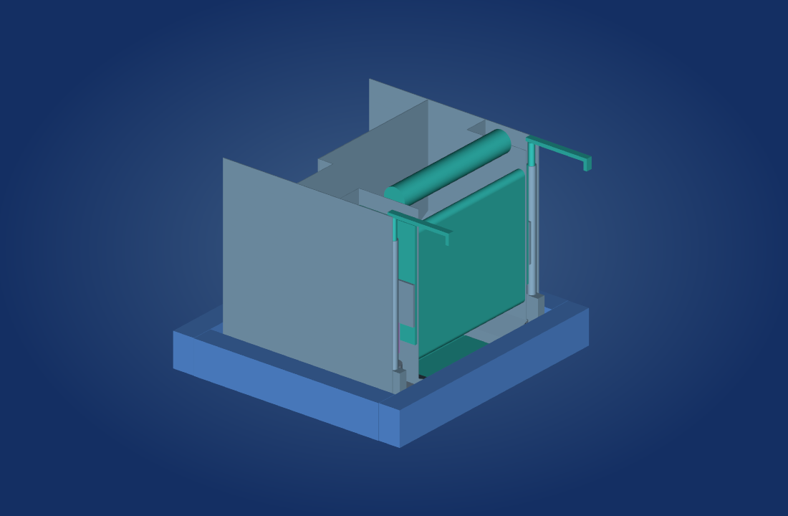
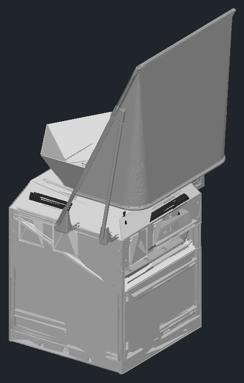
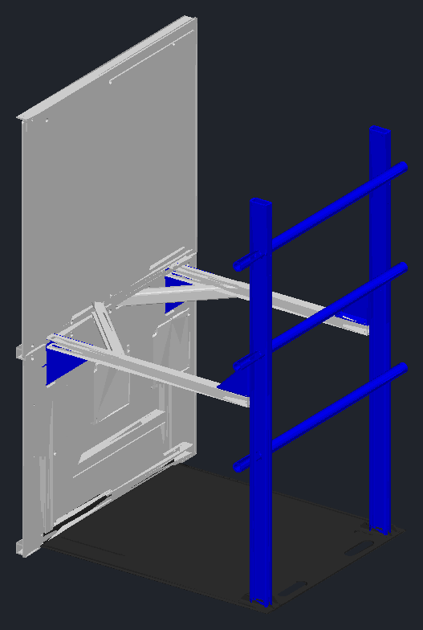
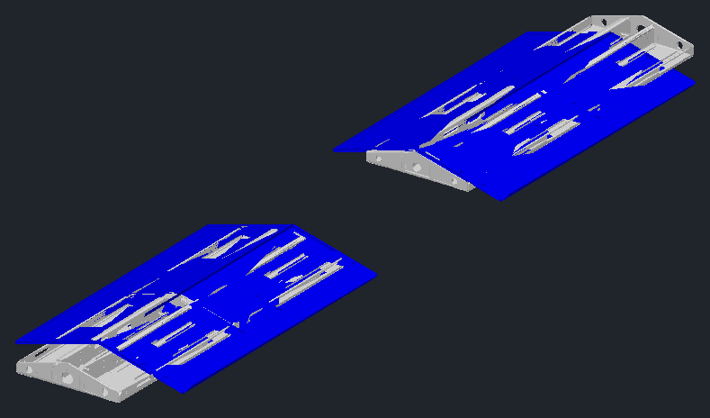

# Official 2026 field fixtures

<!-- cad-still -->
[](https://ehartye.github.io/frc-2026-poc/preliminary-design/)

**Project CAD · Chute-fed hood shooter 1.0, preliminary design · in-progress.** Whole-robot blockout, parked at the end of the park-lower case: back on the carpet after the low-rung hang, with the intake stowed. Field parts and FUEL are hidden. It is not detailed CAD. [Open the design review](https://ehartye.github.io/frc-2026-poc/preliminary-design/)
<!-- /cad-still -->

FIRST's official field model, trimmed to the fixtures the R3 layout's missions touch: the blue HUB the robot scores into, the blue TOWER it hangs from and the blue BUMPs it drives over. They replace the project-drawn planning solids from `experiments/preliminary-design/geometry.py` (`field_bodies`) and the profile in `bump_crossing.py`.

| | |
| --- | --- |
| Source | <https://firstfrc.blob.core.windows.net/frc2026/FieldAssets/FE-2026-rev-rebuilt-playing-field.step> |
| Listed at | <https://www.firstinspires.org/resources/library/frc/playing-field> |
| File | `FE-2026-rev-rebuilt-playing-field.step`, 35,707,894 bytes, SHA-256 `2ad90e42f2c2db0fab5b22bb65aa0851089e414d568d4ebd127624fa230c7671` |
| Edition | Onshape STEP AP242 export stamped 2026-01-07T21:47:03Z; server Last-Modified 2026-01-10. It predates the later dimension drawing revisions. |
| Retrieved | 2026-11-22 |

The whole-field file is not kept here. `official-field.json` is the record: source, hashes, products, placements, frames and mesh counts.

## Files

| Fixture | STEP | Official products | Leaf parts |
| --- | --- | --- | --- |
| Blue HUB | `blue-hub.step` (19.3 MB) | `GE-26300: Hub <2>` | 1,039 |
| Blue TOWER | `blue-tower.step` (1.9 MB) | `GE-26500: Tower <2>` | 202 |
| Blue BUMPs | `blue-bumps.step` (1.9 MB) | `GE-26100: Bump <4>`, `GE-26100: Bump <3>` | 472 |





Each STEP holds the official root `FE-2026: REBUILT Playing Field`, the selected top-level occurrences and everything below them. `extract.py` copies the records from the official file as written, so product names, geometry, colours and the official field placement are unchanged. The file is in millimetres, Z up, origin at the field centre on the carpet. The blue alliance wall is at +X (x = 8,269.288) and the scoring table at +Y. The blue end is the one carrying AprilTags 17 to 32.

- `<id>.parts.json` lists every placed leaf part with its bounds in the official frame, the project field frame and the layout's robot frame.
- `<id>.meshes.json` holds display meshes in the project field frame, as `fieldBodies` for a review replay set (`{name, category, color, mesh: {v, f}}`, millimetres). Fasteners and small parts are left out. The meshes are per-part closed surfaces merged by group. Thin sheet parts leave some unshared edges. The fuel counter and the BUMP bases are hidden in normal views and can be dropped to lighten a page.

## Frames

Project blue field frame from `kickoff/field-profile.json` (651.2 x 317.7 in), millimetres: `field = (8270.24 - x, 4034.79 - y, z)`. The official HUB centre (x = 3,644.9, y = 0) lands on the profile's (182.1, 158.85) in.

The layout has no single field pose. `build_package.py` draws the HUB and the TOWER separately in the robot frame and each case moves them. The robot frame is parallel to the official axes, +X toward the blue alliance wall. Each frame is a 3 x 4 matrix from official millimetres, in `official-field.json` under `dockFrames`.

| Frame | Registration |
| --- | --- |
| `shot-pose` (HUB) | Robot centre 2,700 mm on the alliance-wall side of the HUB centre, on its centreline: `robot = (x - 6345, y, z)`. The acquire pose the layout draws is this shifted by (-400, -2000, 0). |
| `as-drawn` (TOWER) | The TOWER where the layout draws it for the shot pose: the field-side face of the uprights at X = 1,025 and the rung centre at Y = -1,250. This is a drawing position. In the `shot-pose` frame the same face is at X = 818.8 and the rung centre at Y = 288.9. |
| `crossing` (BUMP) | The side view `bump_crossing.py` uses: x along the crossing from the crest line, z up. |

## Against the planning solids

All values are millimetres in the robot frame named.

### HUB, `shot-pose`

| Feature | Planning solid | Official | Difference that matters |
| --- | --- | --- | --- |
| Body plan | 1,193.8 square, front face at X -2,103.1 | 1,193.8 square (panels x 3,047.6 to 4,242.2, y -596.9 to 596.9), front face at X -2,102.9 | None. |
| Body height | Square box to Z 1,777 with a top plate to 1,828.8 | Square panels to Z 1,273.2. Diffusers and roof inside the square to Z 1,515. | The square body is 503.8 mm lower. From Z 1,515 to 1,828.8 only the funnel stands, so there is open air where the stand-in has box wall. |
| Opening height | Z 1,828.8 | Funnel top edge at Z 1,828.8 (`GE-26329`) | None. |
| Opening shape | Hexagon, corners 529.6 from the centre on the Y axis, flats facing X at 458.6 | Hexagon, corners 609.8 from the centre on the X axis, flats facing Y at 528.1 | The official opening is 30 deg from the stand-in and larger. Along the shot line it reaches 151.2 mm farther at each end. Off the centreline it keeps its 1,056.2 width where the stand-in tapers. |
| Below the opening | Straight hexagonal hole down to Z 1,000 | Funnel walls taper to a 762.0 x 685.8 base at Z 1,433.6 | A FUEL entering near the rim meets a sloping funnel wall. |
| Net | Not drawn | `GE-26318` on the neutral-zone side: X -3,555 to -2,887, Y -706 to 706, Z 1,664 to 3,019; poles to Z 3,058 | A shot that carries past the opening meets the net. Its nearest edge is 187 mm beyond the HUB centre. |
| Fuel counter and exits | Not drawn | `GE-26400` inside the body, Z 762 to 1,151 | Hidden. It sets where scored FUEL comes back out. |

### TOWER, `as-drawn`

| Feature | Planning solid | Official | Difference that matters |
| --- | --- | --- | --- |
| Uprights | X 1,025.0 to 1,113.9, inner faces 409.6 each side of the centre, 38.1 wide, Z 9.5 to 1,831.3 | X 1,025.0 to 1,113.9 (the other 0.25 farther), inner faces 409.575 each side, 38.1 wide, Z 5.1 to 1,832.0 | Uprights start 4.4 mm lower. |
| Low rung | 42.164 tube at X 1,069.45, Z 685.8, between the uprights only (816.0 long) | `GE-26503`, 42.164 tube at X 1,069.7, Z 685.8, 1,193.8 long | The rung runs 149.2 mm past the outer face of each upright. A hook can land outboard, and anything passing beside an upright at Z 665 to 707 meets it. |
| Upper rungs | Not drawn | Same tube at Z 1,143.0 and 1,600.2 | Parts rising between or beside the uprights meet them. |
| Base plate | X 1,020.4 to 2,168.0, Y within 495.3, Z 0 to 8 | `GE-26501`: X 987.2 to 2,160.0, Y within 495.3, Z 3.2 to 15.5 at the field edge | The front edge is 33.2 mm closer to the robot and 7.5 mm taller. |
| Base angles | Not drawn | Four brackets to Z 40.0, X 987.2 to 1,152.3, at 377.6 to 409.3 and 447.9 to 479.7 each side of the centre | A bumper with its underside at Z 48 passes 8.0 mm over them. |
| Supports to the wall | Not drawn | Tubes behind each upright, Z 892.2 to 936.6, from X 1,118.9 to the wall. Gussets on the uprights, Z 936.6 to 1,101.7, to X 1,279.3. Braces at Z 889.0 to 939.8 from X 1,735.8. Wall panel at X 2,130.2. | Anything reaching past the uprights at Z 889 to 1,102 meets them. The wall is 1,105.2 mm behind the upright face. |

### BUMP, `crossing`

| Feature | Planning profile | Official | Difference that matters |
| --- | --- | --- | --- |
| Crest height | 165.43 | 165.42 (`GE-26101`) | None. |
| Ramps | 15 deg, sharp crest | 15.0 deg, crest rounded: 163.8 at 20 mm from the line where the profile has 160.1 | The crest is 3.7 mm fuller 20 mm either side. |
| Ramp foot | Tapers to the carpet 617.4 from the crest | Ends 563.8 from the crest with an edge about 16 mm tall | The official BUMP is 107 mm shorter overall and starts with a step. |
| Width | Not modelled (side view) | Each ramp plastic 1,856.3 wide; bases reach 2,234.8 | Lateral limits for a crossing lane. |

## A discrepancy outside this folder

`kickoff/field-profile.json` places the rehearsal's `blue-tower` target at y = 164.475 in. That is the centre of AprilTag 32. The official rungs and uprights are centred at y = 147.475 in (official y = 288.925), 431.8 mm away, under AprilTag 31. This folder changes nothing there.

## Regenerate

```sh
python -I -B cad/field/official/extract.py PATH/TO/FE-2026-rev-rebuilt-playing-field.step
python -I -B cad/field/official/tessellate.py
```

`extract.py` needs only the standard library and refuses any file but the pinned one. `tessellate.py` needs cadquery-ocp and reads the trimmed files in this folder. `selection.json` names the products, frames and display groups. Keep the downloaded file in its own folder outside the checkout.
