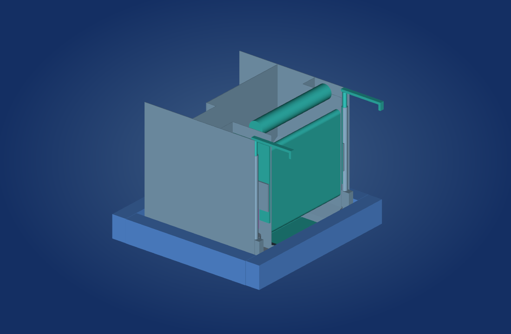

# Preliminary design: Chute-fed hood shooter

<!-- cad-still -->
[](https://ehartye.github.io/frc-2026-poc/preliminary-design/)

**Project CAD · Chute-fed hood shooter 1.0, preliminary design · in-progress.** Whole-robot blockout, parked at the end of the park-lower case: back on the carpet after the low-rung hang, with the intake stowed. Field parts and FUEL are hidden. It is not detailed CAD. [Open the design review](https://ehartye.github.io/frc-2026-poc/preliminary-design/)
<!-- /cad-still -->

This folder holds the checked inputs of the preliminary design. The coding agent checks, stages and publishes the design with its own design tool, Agent FRC; `PLUGIN` below stands for wherever the agent keeps that tool. The project's CI runs none of it and the repository holds no pin to it.

| Version | Design | Status |
| --- | --- | --- |
| `releases/1.0/` | Chute-fed hood shooter: FUEL enter the hopper over the intake's own back plate, a braked feeder roller per lane holds and meters them, and one hooded flywheel with an inertia ring launches them. Level 1 hang on two telescoping hooks. | in progress |

One design has one version folder. An edit to an in-progress design is the next draft of the same version: rebuild, check and stage `1.0` again.

## Rebuild, check and publish

The agent runs these from the repository root with the geometry Python environment.

```sh
python -I -B experiments/preliminary-design/build_package.py --release cad/preliminary-design/releases/1.0 --check --jobs 4
python -I -B experiments/preliminary-design/handoff.py cad/preliminary-design/releases/1.0
python PLUGIN/scripts/stage_preliminary_review.py 1.0
python scripts/preliminary-still.py .
python scripts/cad-readmes.py . --update
node PLUGIN/scripts/design-publication.mjs check .
```

- `build_package.py` writes every input into `releases/1.0/` and, with `--check`, runs the layout check and stops on a non-zero exit. Add `--fail-fast` while fixing a failing layout or `--physics-only` while only geometry or motion changes. This builder and `experiments/preliminary-design/rehearsal/variants.py` still call the agent's tool directly, through the `AGENT_FRC` environment variable. They are due to be replaced by a separate library, and CI does not run them.
- After an edit to names, colours, explanations or grouping only, rebuild without `--check` and run `node PLUGIN/scripts/design.mjs preliminary-check . cad/preliminary-design/releases/1.0/layout.json --view-only --output cad/preliminary-design/releases/1.0/receipt.json`.
- Readiness to be marked effective: `node PLUGIN/scripts/design.mjs effective-readiness . --release cad/preliminary-design/releases/1.0 --design "Chute-fed hood shooter 1.0"`. The owner marks a design effective in a reviewed pull request.
- Review locally: `python PLUGIN/scripts/serve_preliminary_review.py`, then open `http://127.0.0.1:8000/`.
- After the status or draft number changes, edit the status line and caption of `docs/index.html` by hand. No builder writes the entry page.

The physics trials are solved separately by `experiments/preliminary-design/field_trials.py` (about twenty minutes on eight cores) into `experiments/preliminary-design/field-trials.json`. The builder reads that file and does not run a trial. Rerun the trials after changing `dimensions.py`.

## What the folder holds

| File | Holds |
| --- | --- |
| `package.step` | The blockout: one named solid per functional volume, millimetres, robot datum on the carpet at the frame centre, +X toward the intake |
| `field/*.step` | The field fixtures: parts of FIRST's official HUB and TOWER from `cad/field/official/`, placed at the shot pose |
| `layout.json`, `paths.json` | The plan and the motion study: one coarse case for each mission phase, the displaced control and the service cases |
| `contacts.json` | Pairs that are meant to touch: the tracked FUEL against the surfaces its trial presses it on, and official field parts built against each other |
| `budgets.json`, `package-limits.json` | Mass and battery current by subsystem, and what they are compared with |
| `premise-*.json`, `measurements.json` | The premises the layout holds and their measured values |
| `narrative.md` | The strategic narrative the design answers |
| `missions.json` | Mission cases, the cycle map and the risk register with its bench tests |
| `field-trials.json`, `transport/`, `trial-*.json` | The solved physics trials, the trial window each FUEL case follows and the trial records with their qualification |
| `replays.json.gz` | The recorded trials as replay entries of the review page's motion list |
| `receipt.json`, `package-motion.html` | The layout check's receipt and the review page |
| `HANDOFF.md` | The note for detailed design: datums, envelopes, interfaces, operating windows, budgets, risks and first work items, each read from the files above |

The review is one page with one motion list: the checked cases first, then the replays. A replay is playback of the recorded frames. The layout check neither runs nor credits it.
