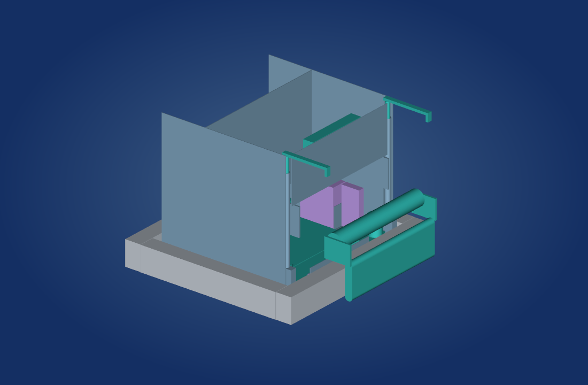

# R3 preliminary design review inputs

<!-- cad-still -->

**Preliminary design · in progress · layout-001.** R3 floor-fed hooded flywheel shooter on four-module swerve. Parked pose of the park-lower case: the robot back on the carpet after the low-rung hang. Whole-robot block-level layout from the layout-checked review scene: 57 representative solids, with the HUB and TOWER field fixtures and the three FUEL hidden. It is not detailed CAD. [Open the review](https://ehartye.github.io/frc-2026-poc/preliminary-design/) · [Layout-checked receipt · 3cfbe1ca75](../../docs/preliminary-design/releases/layout-001/receipt.json)
<!-- /cad-still -->

This folder follows the Agent FRC 0.93.0 whole-robot review layout template. `releases/layout-001/` holds the editable inputs for the R3 floor-fed hood shooter: design, layout, package STEP, paths, limits, budgets, narrative, premises, checker receipt and the checked package player. It is the R3-PD2 package written by `python -I -B experiments/preliminary-design/build_package.py --release cad/preliminary-design/releases/layout-001`, so every pin resolves inside the release directory. The tracked FUEL's cases are fitted to the physics trials in `field-trials.json`. The receipt and player are regenerated with `preliminary-check --write-view --require-checked` when the release is staged.

- Stage a release: `python cad/preliminary-design/stage.py layout-001`.
- Audit the index: `python cad/preliminary-design/stage.py --check-index`.
- Review locally: `python cad/preliminary-design/serve.py`, then open `http://127.0.0.1:8000/`. For a LAN review, add `--bind LAN_ADDRESS --port PORT`.

The free-piece acquisition, hopper entry, launch, delivery and hang trials play in the [field-interaction player](releases/layout-001/field/r3-field-trials.html), which ships inside the release. `pages-workflow.yml` is the template's starter workflow. It is not installed, because the season showcase already deploys Pages.

The interacting field parts are motion-study fixtures (`field-fixtures.step`, registered under each case's `fixtures` with their source, dimensions and placement). They stay in the clearance checks but carry no robot mass, and **Fit field interaction** frames them.

The stable index's "main robot page" link (`../`) is part of the plugin's gated viewer. It resolves on the deployed GitHub Pages site, where `preliminary-design/` sits under the season showcase. A local server rooted at `docs/` has no season index there, so the link returns to this review.
