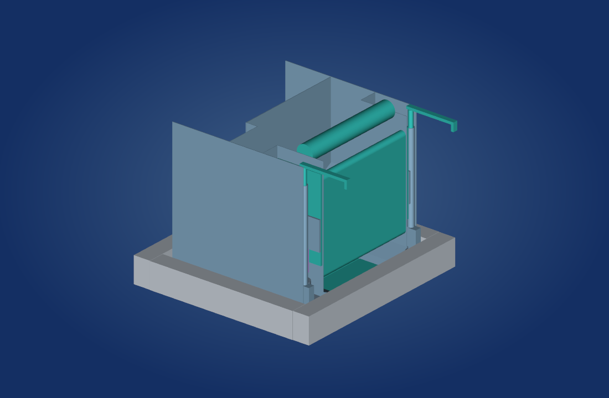

# R3 preliminary design review inputs

<!-- cad-still -->

**Preliminary design · in progress · layout-002.** R3 floor-fed hooded flywheel shooter with a chute intake on four-module swerve. Parked pose at the end of the park-lower case: the robot back on the carpet after the low-rung hang, with the intake stowed. Whole-robot block-level layout from the layout-checked review scene: 68 representative solids, with the six HUB and TOWER field fixtures and the two FUEL hidden. It is not detailed CAD. [Open the review](https://ehartye.github.io/frc-2026-poc/preliminary-design/) · [Layout-checked receipt · cd0d165638](../../docs/preliminary-design/releases/layout-002/receipt.json)
<!-- /cad-still -->

This folder holds the checked inputs of each R3 preliminary design release and the scripts that publish them. It follows the Agent FRC publication workflow (the plugin commit is the `AGENT_FRC_REF` line of `.github/workflows/design-publication.yml`): one release folder per issue, checked with the repository as the project root, and staged into `docs/preliminary-design/`.

| Release | Issue | Design | Status |
| --- | --- | --- | --- |
| `releases/layout-002/` | R3-PD3 | Floor-fed hooded flywheel shooter with a chute intake: FUEL enter the hopper over the intake's own back plate, a braked feeder roller per lane holds and meters them, and one flywheel with an inertia ring launches them | in progress |
| `releases/layout-001/` | R3-PD2 | Floor-fed hooded flywheel shooter with a low open throat | superseded by layout-002 |

`releases/layout-002/` is written by `experiments/preliminary-design/build_package.py --release cad/preliminary-design/releases/layout-002` after `field_trials.py` has solved the physics trials. Set `AGENT_FRC` to the plugin checkout, and check that the builder exits 0 before running the layout check. Every pin in it is a path from the repository root. It holds the layout plan, the placed STEP and field fixtures, the motion study, budgets and limits, premises, the narrative, `field-trials.json`, one trial-window record per tracked-FUEL case under `transport/`, the four trial records for the hold-back, the hopper cycle, the batch and the hang, `replays.json.gz` (those four trials as replay entries, written by `replay_set.py` from the frames recorded in `field-trials.json`), `missions.json` (mission cases, the cycle map and the risk register), `verification-gates.json` (the same risk register with its bench tests), the review page and the `layout-checked` receipt.

- Check a release: `node PLUGIN/scripts/design.mjs preliminary-check . cad/preliminary-design/releases/layout-002/layout.json --require-checked --write-view --jobs 8 --output cad/preliminary-design/releases/layout-002/receipt.json`. An edit to layout-002 is a revision of layout-002: rerun the check in the same folder and stage the same ID.
- Report readiness to be marked effective: `node PLUGIN/scripts/design.mjs effective-readiness . --release cad/preliminary-design/releases/layout-002`.
- Stage a release: `python cad/preliminary-design/stage.py layout-002`, then `node PLUGIN/scripts/design-publication.mjs check .`.
- Change a status: `python cad/preliminary-design/stage.py --set-status layout-002 effective --readiness PLUGIN/scripts/effective-readiness.mjs`. The owner marks a release effective in a reviewed pull request.
- Review locally: `python cad/preliminary-design/serve.py`, then open `http://127.0.0.1:8000/`. For a LAN review, add `--bind LAN_ADDRESS --port PORT`.

The review is one page with one motion list. The tracked FUEL's cases play strokes fitted to the solved trial traces. After the checked cases the list holds four replays of recorded trials: collect, hold and feed 24 FUEL; hold the staged FUEL off the flywheel; launch 24 FUEL through the one flywheel; and lift on the low rung. A replay is playback of the recorded frames. The layout check neither runs nor credits it.

The interacting field parts are motion-study fixtures (`field-fixtures.step`, registered under each case's `fixtures` with their source, dimensions and placement). They stay in the clearance checks but carry no robot mass, and **Fit field interaction** frames them.
