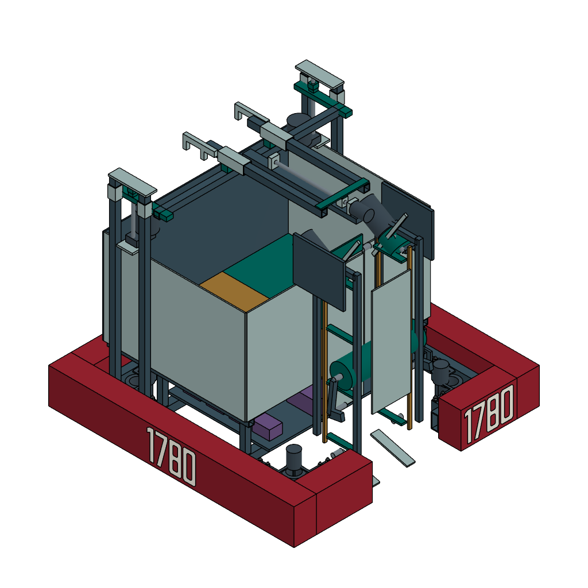
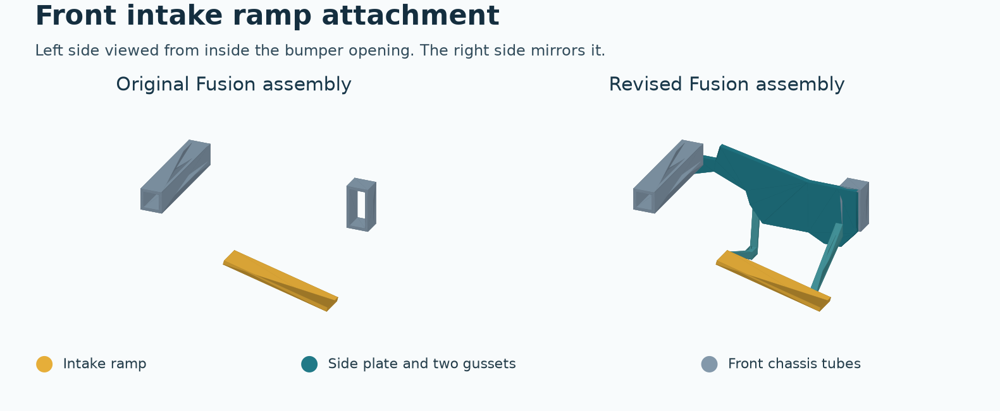

# Red 1780 robot assembly



Open [display.f3d](display.f3d) in Fusion to inspect the four swerve corners, upper assembly and tower in their parked positions. The 235-component public foundation is the basis for this display. Five bumper bodies use the red alliance finish. Sixteen editable white ink extrusions spell **1780** on the left side, right side, rear and left front return. A full number fits the 190 mm front return alongside the intake opening. Each group spans 165 × 100 mm with 13 mm primary strokes.

The still above is the preview Fusion wrote inside the downloadable archive. The [orbitable GLB](display.glb) was tessellated from [the STEP](display.step) exported after the exact F3D reopened. The [provenance record](provenance.json) binds all four files to their digests and records the public model scope. [The fresh Fusion inspection](native-reopen.json) records component appearances and graphics visibility.

Bumper bodies in this revision represent the installed envelope. Their inherited Steel material assignment and the 0.12 mm ink relief are excluded from bumper mass estimates. Construction and service evidence for the layered bumper belongs to its own revision. Public module and motor envelopes retain their positions from the [qualified foundation](../assembly-release/engineering.md). Purchased models are registered separately for local engineering use.

## Intake attachment



At the front opening, follow each sloped 4 mm ramp outward through its two 8 mm bridge gussets to a 6 mm chassis cheek. The cheek seats against the exposed forward face of the deck crossmember and the inboard face of the front return tube. In the previous red model, each ramp was isolated and its nearest neighbor was 36.58 mm away. The current archive has 257 one-solid components. The original 235 foundation shapes and all 16 number strokes keep their positions.

| Interface on each side | Contact area on issued STEP |
| --- | ---: |
| Ramp to either gusset | 31.15 mm² |
| Aft / forward gusset to cheek | 118.92 / 119.99 mm² |
| Cheek heel to crossmember | 131.99 mm² |
| Cheek toe to front return | 291.15 mm² |

All twelve interfaces seat at zero nominal overlap. Four paths per side remain when all unrelated components, including the roller, shafts and artwork, are excluded. Removing both gussets or the cheek breaks that connection. Fusion independently reopens both five-member rigid groups with Aluminum 6061 on every member. The contact graph still contains a separate 43-component roller/elevator group and five isolated products in the upper assembly. [Native groups](ramp-groups.json) · [Contact areas](ramp-fit.json) · [Whole-assembly graph](attachment-graph.json) · [Fourteen omission controls](gusset-omissions.json)

**Shop assembly.** Cut the six project plates in 6061-T6 stock using the [dimensioned profiles](ramp_support.py) in robot millimetres. The two cheeks are mirrored. The bridge center stations are X218 and X317. Fixture the cheeks first against both frame members, with the top of each heel at Z120 below the electronics shelf at Z122. Fit each original ramp and both bridges before installing the shelf, roller or bumpers. Weld both ends of each gusset at its junction with the cheek and the ramp, and weld each cheek to both the crossmember and front return. Keep welds off the rolling face and inspect the underside before installing the intake. The study establishes nominal seats, assembly relationships and clearances. Weld sizing, process qualification and impact capacity remain open.

**Motion envelope.** From the parked roller angle of 84° through −39°, the five moving roller, arm and journal parts clear all six supports. The smallest conservative bound is 26.93 mm at the roller. The 75.057 mm-radius game piece clears the supports by 15.13 mm on the original centered approach through 0.42365 s. Shifting that recorded path 10 mm sideways leaves 7.13 mm. A 25 mm shift intrudes 3.93 mm into a forward gusset. A new contact-dynamics run would be needed to predict the resulting deflection or capture. [Sweep](ramp-swing.json) · [Piece clearance](pickup-clearance.json) · [Pickup trace](../../experiments/own-zone-cycle/replay.json)

## Reproduce the display

1. Obtain the predecessor red archive at commit `25df8858ffa118469e9fefdbc5ff392de6e3a1ae` from `cad/showcase-red/display.f3d`. Run [display_fusion.py](display_fusion.py) through Fusion with a manifest giving the repository root in `project`, the predecessor in `inputArchive`, a local `evidenceDirectory` and `mode` set to `repair-ramps`. That pass authors six extrusions and the two assemblies, closes the saved document, and reopens the F3D to export STEP and inspect the bodies. Mode `inspect-ramps` repeats only the separate native group readback.
2. Run `python cad/showcase-red/extract_preview.py` to extract the embedded Fusion PNG. Run `python cad/showcase-red/build_orbit.py` in the project CAD Python environment to compare the solids, tessellate the verified STEP and bind the public exports.
3. From this folder, run the following geometric checks in the CAD Python environment.

```sh
python ramp_fit.py display.step ramp-fit.json --issued
python showcase_contacts.py display.step attachment-graph.json --anchor "front deck crossmember" --require "left intake ramp" --require "right intake ramp" --intake-supports
python gusset_omissions.py display.step . gusset-omissions.json --issued
python ramp_swing.py display.step . ramp-swing.json --issued
python pickup_clearance.py ../../experiments/own-zone-cycle/replay.json . pickup-clearance.json --issued display.step
```
