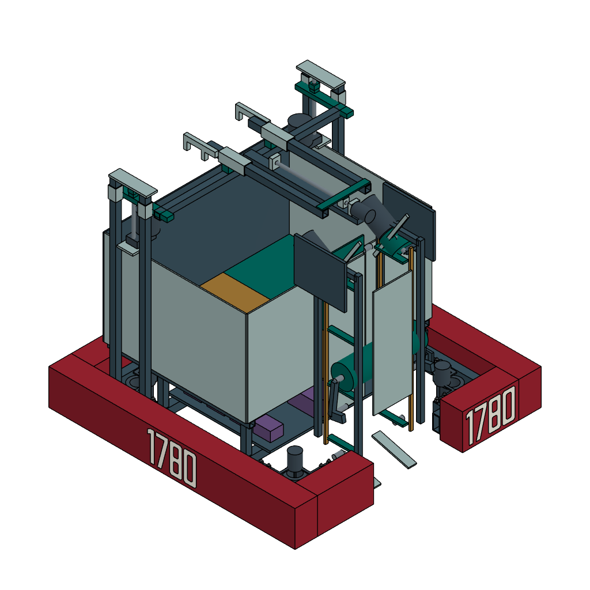

# 2026 preliminary design releases

<!-- cad-still -->
[](https://ehartye.github.io/frc-2026-poc/#model)

**Project CAD · Robot 1780 with red alliance bumpers.** Parked Fusion assembly with four swerve modules, a rear lift and two floor intake ramps supported by gussets on both sides. Purchased components use public project-drawn representations. [Editable Fusion assembly](../../cad/showcase-red/display.f3d) · [STEP](../../cad/showcase-red/display.step) · [Rotate the model](https://ehartye.github.io/frc-2026-poc/#model)
<!-- /cad-still -->

The still above shows the current published robot. These releases review preliminary blockouts that are layout-checked but not yet detailed in Fusion.

Open [the release index](./) for the latest review. To pin a revision, use [release 001](./?release=001). The optional `case` parameter opens a named motion, for example `?release=001&case=climb-lift`.

From the season checkout, run `python -m http.server 8000 --directory docs` and open `http://localhost:8000/preliminary-design/`. For a LAN review, bind the server to the host's LAN address and open that address on the second device. The static files also run under the repository subpath on GitHub Pages.

Each numbered directory holds a complete release:
- its launch page, scripts and styling;
- the compressed scene;
- the field-interaction trial player;
- the release record.

The viewer loads the compressed JSON in the browser. `release.json` pins every input by SHA-256: the layout plan, the checker receipt, the budgets, the verified package player, the STEP, the motion study and the field trials.

To issue a release, write its configuration beside the package (release 001 uses [`review-release-001.json`](../../experiments/preliminary-design/review-release-001.json)). Then run:

```sh
python -I -B scripts/preliminary_review.py experiments/preliminary-design/review-release-001.json
```

Add `--check` to verify that a committed release still matches its inputs. A new release gets a new directory and an entry in `releases.json`. Update `latest` only after you have verified the release. Keep the directories of earlier releases intact.

The geometry is the preliminary R3 blockout, not a Fusion robot. The HUB and TOWER are dimensioned planning blocks in the robot datum. Check the evidence and open qualifications in each case before you use a result for a design decision.

**Publication.** The season's Pages site is the built robot showcase, and the mechanical model eligibility gate rejects any built output that is not in its approved site. This directory is therefore served locally and from the repository. It joins the deployed site only through a signed staged issue or a re-approved showcase baseline.
