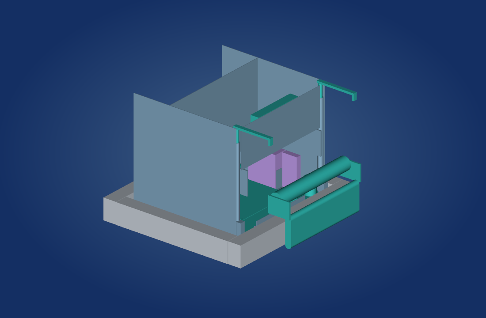

# R3-PD2 LAN review bundle

<!-- cad-still -->
[](https://ehartye.github.io/frc-2026-poc/preliminary-design/)

**Preliminary design · in progress · layout-001.** R3 floor-fed hooded flywheel shooter on four-module swerve. Parked pose of the park-lower case: the robot back on the carpet after the low-rung hang. Whole-robot block-level layout from the layout-checked review scene: 57 representative solids, with the HUB and TOWER field fixtures and the three FUEL hidden. It is not detailed CAD. [Open the review](https://ehartye.github.io/frc-2026-poc/preliminary-design/) · [Layout-checked receipt · 3cfbe1ca75](../../../docs/preliminary-design/releases/layout-001/receipt.json)
<!-- /cad-still -->

The still above is the current published robot. This bundle reviews the preliminary R3 design, which is layout-checked but not yet detailed in Fusion.

This folder holds only the review pages for issue R3-PD2: `package-motion.html` with its compressed geometry `package-motion.geometry.json.gz`, the geometric clearance player (committed; both SHA-256 values are pinned in `receipt.json`), and `field-interaction.html`, the physics trial player (committed; rebuild it with `python -I -B experiments/preliminary-design/field_trials.py`). Both pages are self-contained: they load no external scripts. Private CAD and supplier models are not in it.

## Build the page

From the project root, with the CAD Python environment selected:

```powershell
$env:PYTHON = '<cad python>'
node <agent-frc>/scripts/design.mjs preliminary-check . experiments/preliminary-design/layout.json --write-view --quiet > $null
```

The receipt records the page's SHA-256 (`view.sha256` in [receipt.json](../receipt.json)). A page earns credit only if its bytes match.

## Serve it on the LAN

```powershell
python -m http.server 8765 --bind <host LAN address> --directory experiments/preliminary-design/review
```

Open `http://<host LAN address>:8765/index.html` on the host and then on a second device. Stop the server with Ctrl+C. The folder stays usable as a static bundle after the host shuts down.

## What to check

1. Reset the view, orbit a full revolution and underneath, pan, zoom, and toggle the labels.
2. Play `intake-deploy` through `park-lower` in order. The tracked FUEL follows the trial traces: `acquire-*`, `hopper-*` to its seat against the stopped flywheel, `launch-*` (back-off, coast, feed, wrap) and the four `flight-*` strokes into the HUB cavity.
3. Select a component and read its purpose and rationale.
4. Open the mass and power ledgers.
5. In `field-interaction.html`, play the chain `acquire-nominal`, `entry-nominal`, `launch-nominal`, `deliver-nominal`. Then play the failing controls: `acquire-belt-locked`, `entry-floor-belt-running-0.6`, `launch-from-pressed-seat-no-back-off`, `deliver-6.40` and `hang-no-brake`.
6. Open the displaced-hood control (`package-displacement-control`). It shows a known failing case.

Expected scope: the represented package, cases and reserves. The issue's status is `layout-checked`; read what stays open in [the study](../study.md).
